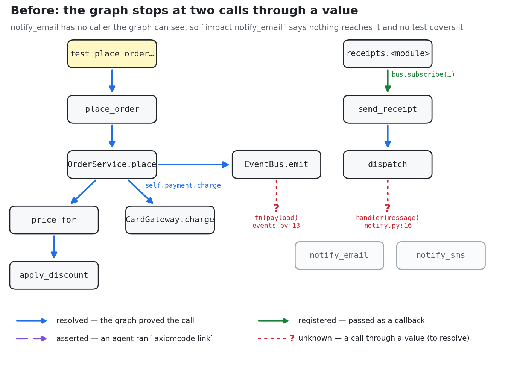
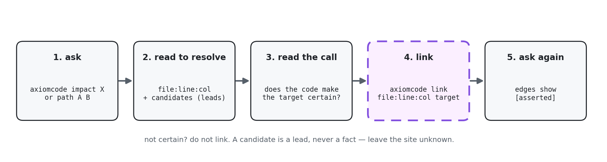
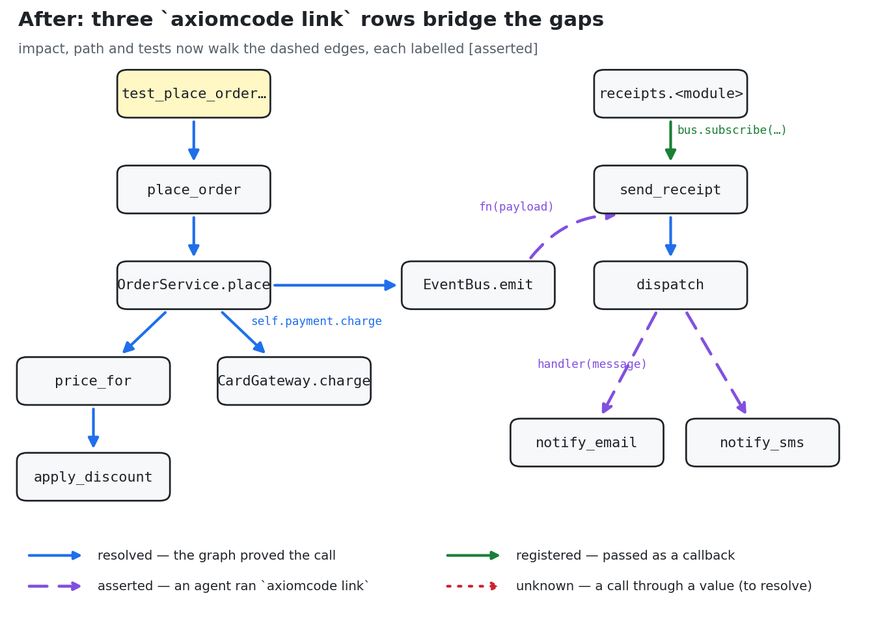

# axiomcode-graph use cases

This repo is a **guided tour of `axiomcode`**, a tool that builds a call graph of your code and answers
questions about it: *who calls this?*, *what breaks if I change it?*, *which tests should I run?*

The tour uses a tiny shop service (8 small Python files and 4 tests) so you can see every answer on one screen
and check it by hand. Every output shown below is **real**. It was copied from the files in [`logs/`](logs/),
and you can reproduce all of it in about a minute.

By the end you will know:

1. what each `axiomcode` command is for, and when to reach for it;
2. how to read an answer, including **how sure** the tool is about each line;
3. what to do when the tool says *"I don't know"*: how an agent closes that gap with `axiomcode link`.

---

## What this repo answers

| Question | Where it is answered |
|---|---|
| **Where and how can the commands be used?** | [What it is for](#what-it-is-for) below lists each command with the question it answers; [Part 3](#part-3-scenarios) runs every command in a concrete scenario (S1–S11) |
| **What goes in, what comes out?** | Every scenario shows the exact command (**Run**) and its real output (**Output**), explained line by line (**How to read it**) |
| **Where do you see the change reflected?** | [Where a change shows up](#where-a-change-shows-up) below; before/after comparison in [S8](#s8-ask-again-the-same-questions-now-have-answers); diagrams [before](diagrams/01-before-link.png) / [after](diagrams/02-after-link.png) |
| **What kinds of things is it good for?** | [What it is for](#what-it-is-for): impact of a change, call chains, test selection, onboarding, closing gaps |
| **How is certainty communicated to the agent?** | Graph → agent: every row is labelled `resolved` / `registered` / `asserted`, and gaps come back under `to resolve:` with a `bound:` warning ([Part 1](#three-kinds-of-edges), [S6](#s6-where-exactly-did-the-graph-stop), [Part 4](#part-4-reading-certainty-a-reference)). Agent → graph: `axiomcode link` records a call the agent is certain of, and `not:` rejects a lead ([S7](#s7-the-agent-closes-the-gap-with-axiomcode-link), [S11](#s11-undo-a-link-and-what-link-refuses)). Instructions to give the agent: [Part 5](#part-5-teach-your-agent) |
| **Real examples and logs?** | Every output is copied from [`logs/`](logs/) (19 files, one per command), and each claim is checked against `pytest` under **Check it yourself** |

## What it is for

| You want to… | Command | Scenario |
|---|---|---|
| know who calls a function, what a change reaches, which tests cover it | `axiomcode impact <name>` | S2, S3, S5 |
| see how A reaches B, hop by hop, with the code at each call | `axiomcode path <A> <B>` | S6, S8 |
| run only the tests your uncommitted edits reach | `axiomcode tests` | S9 |
| check what your uncommitted edits affect | `axiomcode impact` (no name) | S9 |
| understand how a feature works, starting from a question in English | `axiomcode context "<question>" --source` | S4 |
| find calls that text search misses (interfaces, dependency injection, callbacks) | `axiomcode impact <name>` | S3 |
| record where an unresolved call goes, once the code makes it certain | `axiomcode link <file:line:col> <target>` | S7, S10, S11 |
| browse the whole codebase as one interactive page | `axiomcode graph` | FAQ |

## Where a change shows up

| After you… | Look here | You see |
|---|---|---|
| run `axiomcode index` | `.axiomcode/` (derived; safe to delete) | the graph; edge counts per kind in the index output (S1) |
| run `axiomcode link` | [`axiomcode-links.tsv`](axiomcode-links.tsv) at the repo root (commit it) | one row per link (S7) |
| run `axiomcode link` | `axiomcode link` with no arguments | each link and its status: `applied`, `changed`, `moved` (S10) |
| run `axiomcode link` | any `impact` / `path` / `tests` / `context` answer | edges labelled `[asserted]`, and `to resolve: nothing — settled by links` (S8) |
| edit code | the next query | the graph refreshes on its own; `impact` with no name says `your edits: …` (S9) |
| run `axiomcode graph` | `.axiomcode/graph/graph.html` | the whole graph in a browser |

---

## Contents

- [Run it yourself](#run-it-yourself)
- [Part 1: The ideas in two minutes](#part-1-the-ideas-in-two-minutes)
- [Part 2: The example app](#part-2-the-example-app)
- [Part 3: Scenarios](#part-3-scenarios)
  - [S1. Build the graph](#s1-build-the-graph)
  - [S2. "If I change `price_for`, what is affected?"](#s2-if-i-change-price_for-what-is-affected)
  - [S3. "Who calls `CardGateway.charge`?" (grep finds nothing)](#s3-who-calls-cardgatewaycharge-grep-finds-nothing)
  - [S4. "How does placing an order send the receipt?"](#s4-how-does-placing-an-order-send-the-receipt)
  - [S5. The trap: `notify_email` looks safe to change](#s5-the-trap-notify_email-looks-safe-to-change)
  - [S6. Where exactly did the graph stop?](#s6-where-exactly-did-the-graph-stop)
  - [S7. The agent closes the gap with `axiomcode link`](#s7-the-agent-closes-the-gap-with-axiomcode-link)
  - [S8. Ask again: the same questions now have answers](#s8-ask-again-the-same-questions-now-have-answers)
  - [S9. "I edited a file. Which tests do I run?"](#s9-i-edited-a-file-which-tests-do-i-run)
  - [S10. The code moves; the link follows](#s10-the-code-moves-the-link-follows)
  - [S11. Undo a link, and what `link` refuses](#s11-undo-a-link-and-what-link-refuses)
- [Part 4: Reading certainty, a reference](#part-4-reading-certainty-a-reference)
- [Part 5: Teach your agent](#part-5-teach-your-agent)
- [FAQ](#faq)
- [Files in this repo](#files-in-this-repo)

---

## Run it yourself

You need `axiomcode`, Python 3 and `pytest`.

```bash
git clone https://github.com/swapnilpaliwal-sd/axiomcode-graph-usecase
cd axiomcode-graph-usecase
python3 -m pytest -q            # 4 passed: the app works
axiomcode index                 # build the graph (~4 s)
axiomcode impact price_for      # your first question
```

> The repo ships with three links already recorded in `axiomcode-links.tsv` (scenario S7). To see the
> "before" answers of S5 and S6 yourself, move that file aside first: `mv axiomcode-links.tsv /tmp/`.

---

## Part 1: The ideas in two minutes

### The graph

`axiomcode index` reads your code and builds a graph:

- a **node** is a function or method: `place_order`, `OrderService.place`, `notify_email` …
- an **edge** `A → B` means "*A calls B*", and it records the exact line where the call happens.

Every command is a question asked of that graph. For example, *"who calls `price_for`?"* means "follow the
edges backwards from `price_for`", and *"which tests reach my change?"* means "which test nodes have a path
to it".

### Three kinds of edges

Not every edge is equally certain. The diagrams in this repo draw them differently, and the text output
labels each one:

| Drawn as | Label in output | Meaning |
|---|---|---|
| solid blue `→` | `resolved` | The graph **proved** this call from the code: names, imports, types. |
| solid green `→` | `registered` | A function is handed to something that calls it later (`bus.subscribe(…, send_receipt)`). Also proven. |
| purple dashed `- - →` | `asserted` | The graph could not prove it; **an agent read the code and recorded it** with `axiomcode link`. |
| red dotted `···?` (no arrowhead) | `to resolve:` | A **gap**: a call whose target the graph cannot see. |

### Why gaps exist

Most calls name their target, as in `price_for(sku)`. The graph resolves those. Some calls go **through a
value**, and the target is only decided when the program runs:

```python
for fn in self._subs[topic]:      # fn is whatever was subscribed earlier
    fn(payload)                   # ← which function is this?

handler = getattr(module, f"notify_{channel}")   # name built from a string at runtime
handler(message)                                 # ← which function is this?
```

The graph does **not guess** at such a call. It marks the call as a gap, tells you exactly where it is, and
says that any answer passing through it may be incomplete. Closing those gaps is what `axiomcode link` is
for.

---

## Part 2: The example app

```
shop/
  api.py        place_order(request)           the entry point: builds the service, places the order
  service.py    OrderService.place(...)        prices the order, charges the card, emits "order.placed"
  pricing.py    price_for(sku) → apply_discount(amount)
  payments.py   PaymentGateway (abstract) and CardGateway (the real one)
  events.py     EventBus: subscribe(topic, fn) / emit(topic, payload)   ← gap #1: fn(payload)
  receipts.py   send_receipt(order), subscribed to "order.placed"
  notify.py     dispatch(channel, msg) → notify_email / notify_sms     ← gap #2: getattr(...)(msg)
tests/
  test_api.py       places an order end to end and checks an email receipt was sent
  test_pricing.py   two pricing tests
  test_notify.py    SMS truncation
```

**What happens when an order is placed**, in plain words:

1. `place_order` builds an `OrderService` with a `CardGateway` and the global event bus.
2. `OrderService.place` gets the price (`price_for` → `apply_discount`), charges the card through the
   `PaymentGateway` interface, then emits `"order.placed"`.
3. The event bus calls every subscriber of `"order.placed"`. There is one: `send_receipt`.
4. `send_receipt` calls `dispatch("email", …)`, which looks up `notify_email` **by name** and calls it.

Steps 1–2 are ordinary calls, and the graph sees them. Steps 3 and 4 are the two gaps. The picture below is
the graph exactly as the tool sees it after `axiomcode index`:



Notice that `notify_email` and `notify_sms` are greyed out: **nothing the graph can see calls them**, even though
every email receipt goes through `notify_email`.

---

## Part 3: Scenarios

Each scenario follows the same layout:

- **Situation**: what you are trying to find out.
- **Run**: the exact command.
- **Output**: copied from `logs/`, sometimes trimmed (marked `…`).
- **How to read it**: the output, line by line.
- **Check it yourself**: how to confirm the answer without trusting the tool.
- **Takeaway**: the one-line lesson.

---

### S1. Build the graph

**Situation.** A fresh checkout. Nothing has been indexed yet.

**Run**

```bash
axiomcode index
```

**Output** ([`logs/00-index.txt`](logs/00-index.txt))

```console
building python graph for . … (java 0 · typescript 0 · python 12 · javascript 0 · csharp 0 · web 0 files)
indexed .axiomcode/out/python/graph.sqlite [python]: symbols=54 refs=142 literals=38 comments=1 nested_types=0
tier                 edges
known_edge           13
boundary_lib         11
ambiguous_unknown    5
callback_registered  1
datalog rules ready: 4/4 compiled (…)
graph at .axiomcode/out/graph.sqlite
real 4.32
```

**How to read it**

| Line | Meaning |
|---|---|
| `python 12 files` | It detected the language and indexed 12 files (8 in `shop/`, 4 in `tests/`). |
| `known_edge 13` | 13 calls between your own functions were proven. These are the solid blue arrows. |
| `boundary_lib 11` | 11 calls go into the standard library (`round`, `getattr`, …). They are recorded but not followed. |
| `callback_registered 1` | 1 function passed as a callback: `bus.subscribe("order.placed", send_receipt)`. The green arrow. |
| `ambiguous_unknown 5` | 5 calls the graph could not pin down. Two of them are the gaps this tour is about. |

**Takeaway.** One command, a few seconds. The graph lives in `.axiomcode/`, which is derived data: you can delete
it at any time and it is rebuilt. You do not need to run `index` again after editing: later queries notice
edited files and refresh the graph on their own.

---

### S2. "If I change `price_for`, what is affected?"

**Situation.** You want to change how prices are computed. Before touching `price_for`, you want to know who
depends on it and which tests will tell you if you broke something. This is the everyday case: every call
involved is an ordinary, named call.

**Run**

```bash
axiomcode impact price_for
```

**Output** ([`logs/17-impact-price_for.txt`](logs/17-impact-price_for.txt))

````console
1. shop/service.py:24  [resolved · OrderService.place]
   ```python
     23      def place(self, sku: str, qty: int, channel: str) -> Order:
   → 24          total = price_for(sku) * qty
     25          self.payment.charge(total)
     …
   ```
further away (1 place(s), reached through the places above; no code shown):
   shop/api.py:10  place_order  [hop 2]
tests that reach it (2; no code shown):
   tests/test_pricing.py:8,9  test_pen_has_no_discount
   tests/test_api.py:5  test_place_order_sends_email_receipt
verified: ✓ (6 edge(s) looked up again)
````

**How to read it**

| Part | Meaning |
|---|---|
| `1. shop/service.py:24 [resolved · OrderService.place]` | A **direct caller**: `OrderService.place` calls `price_for` on line 24. `resolved` means proven. The code is shown, with `→` on the calling line. |
| `further away … place_order [hop 2]` | **Indirect callers**: `place_order` calls `OrderService.place`, which calls `price_for`. Two hops away. |
| `tests that reach it (2)` | The tests whose call chains reach `price_for`. These are the tests to run after your change. |
| `verified: ✓ (6 edges …)` | Every edge in this answer was looked up again in the graph before it was printed. |

There is no `to resolve:` line and no `bound:` line, so the graph met no gap on the way. **This answer is
complete.**

**Check it yourself.** `grep -rn "price_for" shop tests` shows the same direct caller and test. On a large
codebase the graph also gives you the callers several hops away and the tests behind them, which grep cannot.

**Takeaway.** `impact <name>` answers *who calls it, what it reaches, which tests cover it*, before you edit.

---

### S3. "Who calls `CardGateway.charge`?" (grep finds nothing)

**Situation.** You want to change how card payments work. You search the code for `CardGateway.charge`:

```console
$ grep -rn "CardGateway.charge" shop tests
$                                   # nothing
```

Nothing found. Yet the card **is** charged on every order. The code never writes `CardGateway.charge`. It writes
`self.payment.charge(total)`, where `payment` is declared as the abstract `PaymentGateway`, and `api.py`
passes in a `CardGateway`.

**Run**

```bash
axiomcode impact CardGateway.charge
```

**Output** ([`logs/04-impact-charge-interface.txt`](logs/04-impact-charge-interface.txt), code trimmed)

```console
1. shop/payments.py:6  [must change · declares the same member in a supertype (a name match: this graph has no override table)]
   → 6      def charge(self, amount: float) -> str: ...
2. shop/service.py:25  [resolved · OrderService.place]
   → 25          self.payment.charge(total)
further away (1 place(s), reached through the places above; no code shown):
   shop/api.py:10  place_order  [hop 2]
tests that reach it (1; no code shown):
   tests/test_api.py:5  test_place_order_sends_email_receipt
verified: ✓ (4 edge(s) looked up again)
```

**How to read it**

| Part | Meaning |
|---|---|
| `1. … [must change · declares the same member in a supertype …]` | The abstract `PaymentGateway.charge`. If you change the signature of `CardGateway.charge`, you must change this too. The label says how it knows: *a name match*. |
| `2. … [resolved · OrderService.place]` | The real caller, found through the interface: `self.payment.charge(total)`. |
| `tests that reach it` | Only `test_api` exercises card charging. |

**Check it yourself.** Make `CardGateway.charge` raise an exception and run `python3 -B -m pytest -q`: only
`test_api` fails.

**Takeaway.** The graph follows calls through interfaces and dependency injection, where text search is blind.

---

### S4. "How does placing an order send the receipt?"

**Situation.** You are new to the code and do not know any names yet. You only have a question in English.

**Run**

```bash
axiomcode context "how does placing an order send the receipt" --source
```

**Output** ([`logs/13-context.txt`](logs/13-context.txt), trimmed: the real output shows each step's code)

```console
task terms: placing · order · send · receipt

how it runs — the call flow … (→ resolved call, ⇢ one of a set; ⚠ a call the graph could not resolve …)
   1 send_receipt                     shop/receipts.py:5
   2   → dispatch                     shop/notify.py:14
   3     ⇢ notify_email               shop/notify.py:6
   4     ⇢ notify_sms                 shop/notify.py:10
   5 place_order                      shop/api.py:10
   6   → make_service                 shop/api.py:6
   7     → OrderService.__init__      shop/service.py:18
   8   → OrderService.place           shop/service.py:23
   9     → price_for                  shop/pricing.py:4
  10       → apply_discount           shop/pricing.py:8
  11     → CardGateway.charge         shop/payments.py:10
  12     → EventBus.emit              shop/events.py:11
           ↺ send_receipt (step 1)
```

**How to read it**

| Part | Meaning |
|---|---|
| `task terms:` | The words it took from your question to find starting points. |
| `1 send_receipt`, `5 place_order` | Two **entry points** that matched your words: one for "receipt", one for "order". |
| indentation | Each level is one call deeper. Read it top to bottom as "this calls that". |
| `→` | A proven call. |
| `⇢` | **One of a set**: at runtime it calls *one* of these (`notify_email` or `notify_sms`, depending on the channel). |
| `↺ send_receipt (step 1)` | The flow loops back to a step already shown: `EventBus.emit` ends up calling `send_receipt`. |

**Takeaway.** `context` is the front door: start here when you do not know the names yet. Then use `impact` or
`path` on the names it gives you.

> This output was captured **after** the links of S7. Steps 3–4 and the `↺` rest on those links.

---

### S5. The trap: `notify_email` looks safe to change

**Situation.** You want to change how email receipts are written. You ask the graph what the change affects.

**Run**

```bash
axiomcode impact notify_email
```

**Output** ([`logs/01-impact-notify_email-before.txt`](logs/01-impact-notify_email-before.txt))

```console
change: notify_email   [method]
directly touches it: nothing the graph can see — the declaration is used only where it is declared, or through something the parser did not record
reaches those through resolved calls: 0 more callable(s) in 0 file(s)
tests: 0 of 4 test method(s) reach the change
verified: nothing to check — no entry in this answer claims a CALL EDGE, so there is none to look up
next: nothing resolved depends on it, so the change is local — read shop/notify.py:6 and edit there
```

**How to read it.** The graph found **no caller and no test**. Read the wording carefully: *"nothing the graph
can see"*, *"through something the parser did not record"*. It does not say "nothing calls it". It says it
cannot see a caller.

**Check it yourself.** Break `notify_email`, for example change `message` to `message.upper()`, and run the tests:

```console
$ python3 -B -m pytest -q
FAILED tests/test_api.py::test_place_order_sends_email_receipt - AssertionError…
1 failed, 3 passed
```

So the change is **not** local: the end-to-end test breaks. The caller exists. It is hidden behind
`getattr(...)(message)` (gap #2 in the diagram above).

**Takeaway.** "Nothing calls it" from a call graph can mean "nothing *visible* calls it". The next scenario shows how
to tell the two apart.

---

### S6. Where exactly did the graph stop?

**Situation.** You suspect the answer in S5 is incomplete. You ask two follow-up questions: *how does
`place_order` reach `notify_email`?* and *what can `dispatch` not resolve?*

**Run**

```bash
axiomcode path place_order notify_email
axiomcode impact dispatch --unknown
```

**Output 1** ([`logs/02-path-before.txt`](logs/02-path-before.txt))

```console
No chain of resolved calls connects place_order and notify_email in either direction (searched 14 edges, depth ≤ 40)
  and no unresolved site would connect them by name either — but place_order makes a call whose callee is a value, not a name (below): any function passed, stored or exported may be what it calls, so the connection is UNKNOWN, not absent
  place_order reaches 1 call(s) through a value:
    `fn()` in EventBus.emit at shop/events.py:13 — the callee is a loop variable
to resolve: 1 call site(s) the answer stopped at — what each reaches is not in it:
    shop/events.py:13:13  fn(payload)  [no_rule]
        candidates: no candidate
    read the call first; when it makes the target certain: `axiomcode link <file:line:col> <target>` (a candidate is a lead, never link it by its rank)
```

**Output 2** ([`logs/03-impact-dispatch-unknown.txt`](logs/03-impact-dispatch-unknown.txt), trimmed)

```console
change: dispatch   [method]
reads or uses it (1 callable(s): 1 resolved):
    [resolved] send_receipt   shop/receipts.py:6   — calls it
…
bound: 1 unresolved call(s) inside the impacted set — what those reach is unknown, so the set is a lower bound
to resolve: 1 call site(s) the answer stopped at — what each reaches is not in it:
    shop/notify.py:16:5  handler(message)  [computed_attribute_name:notify_*]
        candidates: notify_email shop/notify.py:6 (named notify_…, the constant part of the computed name); notify_sms shop/notify.py:10 (named notify_…, the constant part of the computed name)
    read the call first; when it makes the target certain: `axiomcode link <file:line:col> <target>` (a candidate is a lead, never link it by its rank)
```

**How to read it**

| Part | Meaning |
|---|---|
| `the connection is UNKNOWN, not absent` | The key sentence. The graph is telling you that it does not know, which is different from "no". |
| `to resolve:` | The list of **gaps**: the exact call sites where the answer stopped. |
| `shop/events.py:13:13` | `file:line:column` of the call. The column points at the callee name (`fn`). |
| `[no_rule]` / `[computed_attribute_name:notify_*]` | **Why** it could not resolve the call: a loop variable / a name built from `"notify_" + something`. |
| `candidates:` | The graph's **leads**: functions it suspects. Here: anything named `notify_…`. A lead is not a fact. |
| `bound: … lower bound` | The list above may be incomplete because of the gaps. |
| `read the call first; …` | The instruction for the next step: read the code, and link only if the code makes the target certain. |

**Takeaway.** The graph separates *what it knows* from *what it doesn't*, and gives you the exact lines to read to
close the gap.

---

### S7. The agent closes the gap with `axiomcode link`

**Situation.** You (or your coding agent) now read the two lines the graph pointed at, decide where each call
really goes, and record it.



**Step 1: read the code and decide.** The agent's reasoning, written out:

> **Gap #1, `shop/events.py:13` `fn(payload)`.** `fn` comes from `self._subs[topic]`. The only thing ever put in
> `_subs` is `subscribe(...)`. Searching for `subscribe(` finds exactly one call:
> `bus.subscribe("order.placed", send_receipt)` in `receipts.py`. So `fn` is `send_receipt`. **Certain → link it.**
>
> **Gap #2, `shop/notify.py:16` `handler(message)`.** `handler` is `getattr(module, f"notify_{channel}")`. The module
> defines exactly two `notify_*` functions: `notify_email` and `notify_sms`. Which one runs depends on the
> order's channel, so **both** are possible. **Certain that it is one of these two → link both.**

If the agent could **not** reach a certain conclusion, for example because the name came from a config file it
cannot see, the right move is to leave the gap open. An open gap is honest; a wrong link is not.

**Step 2: record the decisions.**

```bash
axiomcode link shop/events.py:13:13 send_receipt
axiomcode link shop/notify.py:16:5 notify_email
axiomcode link shop/notify.py:16:5 notify_sms
```

**Output** ([`05`](logs/05-link-event-bus.txt), [`06`](logs/06-link-dispatch-email.txt), [`07`](logs/07-link-dispatch-sms.txt))

```console
linked shop/events.py:13:13 `fn` → send_receipt [asserted]; return type unknown, calls on its result stay unknown  — applied to 1 graph(s) in 7 ms
linked shop/notify.py:16:5 `handler` → notify_email [asserted]; return type unknown, calls on its result stay unknown  — applied to 1 graph(s) in 6 ms
linked shop/notify.py:16:5 `handler` → notify_sms [asserted]; return type unknown, calls on its result stay unknown  — applied to 1 graph(s) in 6 ms
```

**How to read it**

| Part | Meaning |
|---|---|
| `` `fn` → send_receipt [asserted] `` | The edge was added, labelled `asserted` so that everyone can tell it came from a person or agent rather than from proof. |
| `return type unknown, calls on its result stay unknown` | The link tells the graph *where the call goes*, not *what it returns*. Calls made on its return value stay unresolved. |
| `applied … in 7 ms` | No rebuild. The graph is patched in place, and the next question sees it immediately. |

**Step 3: see where it is stored.** The links are written to [`axiomcode-links.tsv`](axiomcode-links.tsv) at the
repo root:

```tsv
shop/events.py	13	5e1fa3c6d873	fn	EventBus.emit	send_receipt	shop/receipts.py	swapnilpaliwal	2026-10-29T14:03:37	13	0
shop/notify.py	16	c305c8c91dd4	handler	dispatch	notify_email	shop/notify.py	swapnilpaliwal	2026-10-29T14:03:37	5	0
shop/notify.py	16	c305c8c91dd4	handler	dispatch	notify_sms	shop/notify.py	swapnilpaliwal	2026-10-29T14:03:37	5	0
```

Columns, left to right: file, line, a fingerprint of the line's text, the callee as written, the calling function,
the target, the target's file, who linked it, when, the column, plus internal fields. **Commit this file.** It is
reviewed in pull requests like any other change, and it survives rebuilding the graph.

And the graph now looks like this:



The red dotted gaps are gone. Each one is now a purple dashed `[asserted]` edge.

---

### S8. Ask again: the same questions now have answers

**Run** the same two questions as in S5 and S6.

```bash
axiomcode impact notify_email
axiomcode path place_order notify_email
```

**Output 1** ([`logs/09-impact-notify_email-after.txt`](logs/09-impact-notify_email-after.txt))

````console
1. shop/notify.py:16  [calls it | asserted · dispatch]
   ```python
     14  def dispatch(channel: str, message: str) -> None:
     15      handler = getattr(sys.modules[__name__], f"notify_{channel}")
   → 16      handler(message)
   ```
further away (4 place(s), reached through the places above; no code shown):
   shop/receipts.py:5  send_receipt  [hop 2]
   shop/events.py:11  EventBus.emit  [hop 3]
   shop/service.py:23  OrderService.place  [hop 4]
   shop/api.py:10  place_order  [hop 5]
tests that reach it (1; no code shown):
   tests/test_api.py:5  test_place_order_sends_email_receipt
verified: ✓ (7 edge(s) looked up again)
bound: 2 unresolved call(s) inside — a lower bound
to resolve: nothing — 2 site(s) the answer stopped at are settled by links
````

**Output 2** ([`logs/10-path-after.txt`](logs/10-path-after.txt), code trimmed)

```console
1. shop/api.py:12      [resolved · hop 1/5 place_order → OrderService.place]
2. shop/service.py:28  [resolved · hop 2/5 OrderService.place → EventBus.emit]
3. shop/events.py:13   [asserted · hop 3/5 EventBus.emit → send_receipt]
4. shop/receipts.py:6  [resolved · hop 4/5 send_receipt → dispatch]
5. shop/notify.py:16   [asserted · hop 5/5 dispatch → notify_email]
verified: ✓ (5 edge(s) looked up again)
```

**How to read it**

| Part | Meaning |
|---|---|
| `[calls it \| asserted · dispatch]` | `dispatch` calls `notify_email`, and the graph knows it **because of a link**, not because it proved it. |
| `tests that reach it: test_api.py:5` | The test that S5 showed actually breaks. Before the link the graph said 0. |
| `hop 3/5 … [asserted]` | Each hop of the chain carries its own certainty: three proven, two asserted. You can see exactly which parts of the chain rest on someone's judgement. |
| `to resolve: nothing — 2 site(s) … settled by links` | Both gaps are closed. |

**Before and after, side by side**

| Question | Before the links (S5, S6) | After the links (S8) | The truth (pytest) |
|---|---|---|---|
| Who calls `notify_email`? | nobody visible, "the change is local" | `dispatch`, plus 4 further up | `dispatch`, from the order flow |
| Which tests cover it? | 0 of 4 | `test_api` | `test_api` fails when it breaks |
| How does `place_order` reach it? | unknown, stopped at `events.py:13` | 5 hops, 2 of them asserted | — |

**Takeaway.** Three one-line links turned a dangerous answer ("local change, no tests") into a correct one, and
every line that depends on a link still says so.

---

### S9. "I edited a file. Which tests do I run?"

**Situation.** You changed the body of `notify_email` (here: `message` → `message.strip()`) and have not committed.
You want to run only the tests that matter.

**Run**

```bash
axiomcode tests
axiomcode impact          # no name = "whatever my uncommitted edits changed"
```

**Output 1** ([`logs/11-tests-after-edit.txt`](logs/11-tests-after-edit.txt))

````console
1. tests/test_api.py:5  [test · asserted · hop 6]
   ```python
   → 5  def test_place_order_sends_email_receipt():
     6      notify.SENT.clear()
     7      out = place_order({"sku": "book", "qty": 2, "channel": "email"})
     …
   ```
bound: a lower bound: a test reached only by reflection, a service loader, a framework instantiating by name, a subprocess, or a case built at runtime is not here
run: pytest tests/test_api.py
````

**Output 2** ([`logs/12-impact-uncommitted.txt`](logs/12-impact-uncommitted.txt), first lines)

```console
your edits: body shop.notify.notify_email
1. shop/notify.py:16  [calls it | asserted · dispatch]
…
```

**How to read it**

| Part | Meaning |
|---|---|
| `[test · asserted · hop 6]` | The test is 6 calls away from your edit, and the chain includes an asserted link. |
| `run: pytest tests/test_api.py` | A ready-to-paste command that runs exactly these tests. |
| `your edits: body shop.notify.notify_email` | `impact` with no name works out what you changed from your uncommitted diff. |

**Check it yourself.** `test_pricing` and `test_notify` never call `notify_email`, so skipping them is correct.
Without the links from S7, this would have selected **no** tests (S5: "0 of 4").

**Takeaway.** After an edit, `axiomcode tests` gives you the shortest correct test command.

---

### S10. The code moves; the link follows

**Situation.** Someone adds two comment lines at the top of `notify.py`. The linked call moves from line 16 to
line 18. Is the link now broken?

**Run** `axiomcode link` (with no arguments it lists every link and its status), before and after the graph refreshes.

**Output** ([`15`](logs/15-link-after-line-moved.txt), [`16`](logs/16-link-followed-after-refresh.txt))

```console
# right after the edit, before the graph refreshed:
    3. [changed] shop/notify.py:16:5  → notify_email  — the line was edited since the graph was built; the next refresh re-validates it (followed if it only moved)

# after the next query refreshed the graph:
    3. [moved] shop/notify.py:16:5 (now line 18)  → notify_email  — followed by its text from line 16 to 18
```

**How to read it.** Each link stores a fingerprint of its line's text. When the line moves, the link finds the same
text inside the same function and follows it. If the line's text itself changed, the link is re-checked rather
than trusted blindly.

**Takeaway.** Links are not tied to fragile line numbers. They are re-validated whenever the code changes.

---

### S11. Undo a link, and what `link` refuses

**Remove a link.** You realise a link was wrong. Pass `-` as the target:

```console
$ axiomcode link shop/notify.py:16 -
removed 2 link(s) at shop/notify.py:16
```

([`logs/18-link-remove.txt`](logs/18-link-remove.txt).) Without `:col`, every link on that line is removed.

**Reject a lead.** `not:<target>` tells the graph that one of *its own* candidates is wrong. It refuses a target
it never suggested for that site:

```console
$ axiomcode link shop/events.py:13:13 not:notify_sms
axiomcode link: rejected — no by-name or one-of-a-set lead at shop/events.py:13 reaches notify_sms
```

([`logs/14-link-reject.txt`](logs/14-link-reject.txt).)

**Takeaway.** Links are cheap to add, cheap to remove, and checked against the code.

---

## Part 4: Reading certainty, a reference

### Labels on answer rows

| Label | Arrow in diagrams | How sure | What to do |
|---|---|---|---|
| `resolved` | `→` blue | Proven from the code | Trust it |
| `registered` | `→` green | Proven: a function handed over as a callback | Trust it |
| `must change · … name match` | — | A same-named member in a supertype | Check it; usually right |
| `⇢` (in `context`) | — | One of a set: one of these runs, depending on runtime data | Expect any of them |
| `asserted` | `- - →` purple dashed | Recorded by a person or agent with `link` | Trust it as much as whoever linked it; review `axiomcode-links.tsv` in PRs |
| `to resolve:` | `···?` red dotted | A gap: unknown target | Read the call; link it only if certain |

### Lines at the end of an answer

| Line | Meaning |
|---|---|
| `verified: ✓ (N edge(s) looked up again)` | Every edge shown was re-checked before printing. |
| `bound: … a lower bound` | There are gaps inside the answer, so the true set may be **larger**. |
| `to resolve: …` | The gaps this answer met, with `file:line:col`, the reason, and candidates. |
| `to resolve: nothing — N site(s) … settled by links` | The gaps this answer met are all closed by links. |
| `next:` | The suggested next step. |

### Link statuses (`axiomcode link` with no arguments)

| Status | Meaning |
|---|---|
| `applied` | The graph has taken the link; answers use it. |
| `not applied` | Recorded in the file, but the graph has not loaded it yet. The next query loads it. |
| `changed` | The linked line was edited; it is re-checked at the next refresh. |
| `moved` | The line moved; the link followed its text to the new line. |

---

## Part 5: Teach your agent

Paste this into your `CLAUDE.md` / `AGENTS.md`:

```markdown
## Call graph (axiomcode)
- Before changing a function: `axiomcode impact <name>`. After editing: `axiomcode tests`, then run the command it prints.
- New to the code? Start with `axiomcode context "<the task in plain words>" --source`.
- How sure is each row? `resolved` / `registered` = proven. `asserted` = recorded by an agent. `to resolve:` = a gap.
- A `bound: … lower bound` line means the answer may be incomplete. Never call a change "local" while
  `to resolve:` lists sites.
- To close a gap: read the call at the given `file:line:col`. If the code makes the target CERTAIN, run
  `axiomcode link <file:line:col> <target>` (once per possible target). Candidates are leads; never link by rank.
  If you are not certain, leave the gap open and say so.
- Commit `axiomcode-links.tsv` with your change.
```

---

## FAQ

**Does `link` rebuild the graph?** No. It patches the graph in place in a few milliseconds (S7).

**What if `.axiomcode/` is deleted?** It is rebuilt on the next query, and the links in `axiomcode-links.tsv` are
applied again. That is why the links file lives at the repo root and is committed.

**What if a link is wrong?** Remove it with `axiomcode link <file:line> -` (S11). Every row that depends on a link
says `asserted`, so a wrong link is always visible in the answers it affects.

**Should I link a candidate the graph suggested?** Only after reading the code and confirming it. In S6 the
candidates happened to be right. Candidates are matched by name, and in other code they can be wrong.

**Do I have to re-run `index` after editing?** No. Queries notice edited files and refresh the graph. Pass `--fresh`
to wait for the refresh before answering.

**Where can I see the whole graph?** `axiomcode graph` writes `.axiomcode/graph/graph.html`, an interactive page of
directories, files, functions and the calls between them.

---

## Files in this repo

| Path | What it is |
|---|---|
| `shop/`, `tests/` | The example app and its tests |
| `axiomcode-links.tsv` | The three links from S7 |
| `logs/` | The raw output of every command in this README |
| `diagrams/*.png` | The before / after / workflow pictures |
| `diagrams/make_diagrams.py` | Regenerates the pictures: `python3 diagrams/make_diagrams.py` (needs matplotlib) |
