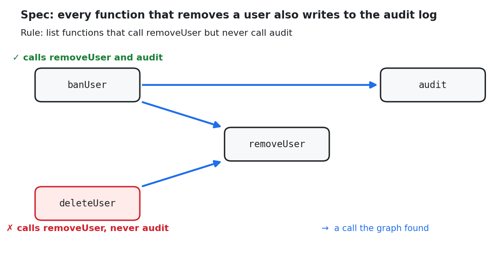

# Spec → rule → check (the simple version)

Turn one sentence of a spec into a rule, and let the graph check it. Three tiny TypeScript files, one SQL query.



## The spec

> Every function that removes a user also writes to the audit log.

## The code

```ts
// src/db.ts
export function removeUser(id: number) { … }

// src/audit.ts
export function audit(message: string) { … }

// src/users.ts
export function banUser(id: number) {
  removeUser(id);
  audit(`banned ${id}`);      // ✓ audits
}

export function deleteUser(id: number) {
  removeUser(id);             // ✗ forgot to audit
}
```

## The rule

The spec, written as a question to the graph: *which functions call `removeUser` but never call `audit`?*
That is [`rule.sql`](rule.sql):

```sql
SELECT f.name AS breaks_the_spec, f.file_path AS file, f.start_line AS line
FROM methods f
WHERE EXISTS (SELECT 1 FROM call_edges e JOIN methods t ON t.id = e.callee_method_id
              WHERE e.caller_id = f.id AND t.name = 'removeUser')
  AND NOT EXISTS (SELECT 1 FROM call_edges e JOIN methods t ON t.id = e.callee_method_id
                  WHERE e.caller_id = f.id AND t.name = 'audit');
```

- `methods`: every function in the code.
- `call_edges`: every call the graph found (`caller_id` calls `callee_method_id`).

**No rows means the spec holds.** Each row is a function that breaks it.

## Step 1: Build the graph

```console
$ axiomcode index
building typescript graph for . … (typescript 3 files)
graph at .axiomcode/out/graph.sqlite
```

## Step 2: Check the spec

```console
$ sqlite3 -header -column .axiomcode/out/graph.sqlite < rule.sql
breaks_the_spec  file          line
---------------  ------------  ----
deleteUser       src/users.ts  9
```

`deleteUser` breaks the spec, at `src/users.ts:9`.

## Step 3: Fix it, check again

```diff
 export function deleteUser(id: number) {
   removeUser(id);
+  audit(`deleted ${id}`);
 }
```

```console
$ axiomcode index
$ sqlite3 -header -column .axiomcode/out/graph.sqlite < rule.sql
                                    ← no rows: the spec holds
```

## Step 4: Someone adds new code later

```ts
// src/cleanup.ts  (new file)
export function purgeInactive(ids: number[]) {
  for (const id of ids) removeUser(id);      // forgot to audit
}
```

```console
$ axiomcode index
$ sqlite3 -header -column .axiomcode/out/graph.sqlite < rule.sql
breaks_the_spec  file            line
---------------  --------------  ----
purgeInactive    src/cleanup.ts  3
```

Nobody changed the rule. It caught the new function because of **what the function does** (it calls
`removeUser`), not because of its name. That is the difference between a rule and a test: a rule also covers code
written after the rule.

## Try it

```bash
cd spec-to-rule
axiomcode index
sqlite3 -header -column .axiomcode/out/graph.sqlite < rule.sql     # shows deleteUser
```

Then add the `audit(...)` line to `deleteUser` and run both commands again.

## Write your own

1. Pick one sentence from your spec.
2. Name the functions it talks about (here: `removeUser`, `audit`).
3. Write it as "list the functions that break it" (here: call `removeUser` **and not** `audit`).
4. Run it after every `axiomcode index`, for example in CI. Any row fails the build.

Raw output of every step: [`logs/`](logs/).
