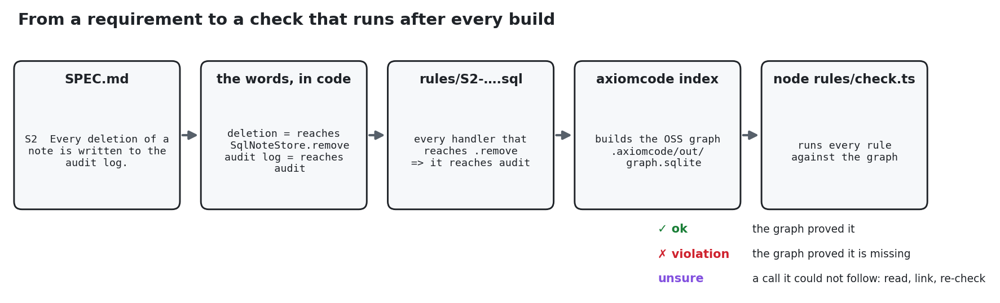
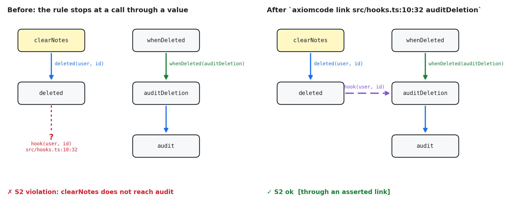

# From a spec to rules, checked against the graph (TypeScript)

The first tour ([../README.md](../README.md)) asks the graph questions one at a time. This one turns a
**written spec into rules** and checks every rule against the graph **each time it is rebuilt**. When the code
drifts from the spec, the check says where, and how sure it is.

It uses only the open-source `axiomcode`. A rule is a short SQL query over the graph `axiomcode index` writes
(`.axiomcode/out/graph.sqlite`). There is no extra tool to install: Node's built-in `node:sqlite` runs the rules.

Every output below is real and copied from [`logs/`](logs/).



---

## Contents

- [Run it yourself](#run-it-yourself)
- [The app](#the-app)
- [Step 1: Write the spec](#step-1-write-the-spec)
- [Step 2: Say what each word means in this code](#step-2-say-what-each-word-means-in-this-code)
- [Step 3: Write each requirement as a rule](#step-3-write-each-requirement-as-a-rule)
- [Step 4: Build the graph and check: the tests pass, the spec does not](#step-4-build-the-graph-and-check-the-tests-pass-the-spec-does-not)
- [Step 5: Fix the code, check again](#step-5-fix-the-code-check-again)
- [Step 6: An agent adds a feature and breaks the spec](#step-6-an-agent-adds-a-feature-and-breaks-the-spec)
- [Step 7: "unsure": the rule meets a call it cannot follow](#step-7-unsure-the-rule-meets-a-call-it-cannot-follow)
- [Step 8: A link cannot fake a pass](#step-8-a-link-cannot-fake-a-pass)
- [How the check reports certainty](#how-the-check-reports-certainty)
- [What else you can write as a rule](#what-else-you-can-write-as-a-rule)
- [Use it in CI and in your agent's instructions](#use-it-in-ci-and-in-your-agents-instructions)
- [Files](#files)

---

## Run it yourself

You need `axiomcode` and Node 22.18 or newer (it runs `.ts` files directly; nothing to `npm install`).

```bash
cd ts-spec-rules
npm test            # node --test: 5 passed
npm run check       # axiomcode index, then every rule in rules/
```

The checked-in code is the final state, so `npm run check` prints `all requirements hold`. The steps below show how
it got there.

---

## The app

A tiny notes API, 9 files:

```
src/
  server.ts            routes: "GET /notes" → listNotes, "POST /notes" → createNote, "DELETE /notes/:id" → deleteNote, …
  handlers/notes.ts    listNotes, createNote, deleteNote (and later clearNotes)
  handlers/admin.ts    exportAll
  auth.ts              requireUser, requireAdmin
  store.ts             interface NoteStore, class SqlNoteStore implements NoteStore
  driver.ts            exec(sql): the raw "database"
  audit.ts             audit(action, user, id)
  hooks.ts             (Step 7) whenDeleted(hook) / deleted(user, id)
test/                  node:test tests
```

Handlers receive a `NoteStore` **interface**, so `store.remove(id)` never names `SqlNoteStore`. The graph
still connects the two. That matters below: a rule like "every handler that deletes…" depends on it.

---

## Step 1: Write the spec

[`SPEC.md`](SPEC.md), in plain English:

| ID | Requirement |
|---|---|
| S1 | Only a logged-in user can change notes. |
| S2 | Every deletion of a note is written to the audit log. |
| S3 | Only the store (`src/store.ts`) talks to the database driver. |
| S4 | Every admin endpoint checks that the caller is an admin. |

---

## Step 2: Say what each word means in this code

A rule cannot check "logged-in" until "logged-in" points at code. This is the step that turns English into
something the graph can answer. It is also in `SPEC.md`:

| Word in the spec | In this code | How the graph sees it |
|---|---|---|
| endpoint / handler | a function in `src/handlers/` | `methods.file_path` |
| change notes | calls `SqlNoteStore.add` or `SqlNoteStore.remove` | the handler **reaches** that method through calls |
| logged-in check | `requireUser` | the handler reaches `requireUser` |
| admin check | `requireAdmin` | the handler reaches `requireAdmin` |
| audit log | `audit` | the handler reaches `audit` |
| database driver | `exec` in `src/driver.ts` | a direct call edge to `exec` |

"Reaches" means "through any chain of calls", including calls through the `NoteStore` interface. That is the part
grep cannot do.

---

## Step 3: Write each requirement as a rule

Each rule is one SQL file. It returns one row per thing the rule is about, with a verdict. The shared words
(`handler`, `reaches`, `blind`) are defined once in [`rules/_views.sql`](rules/_views.sql) on top of the graph's tables.

[`rules/S2-deletion-is-audited.sql`](rules/S2-deletion-is-audited.sql):

```sql
-- S2  Every deletion of a note is written to the audit log.
-- every handler that reaches SqlNoteStore.remove  =>  it reaches audit
-- kind: requires
SELECT h.name AS subject, h.file, h.line,
       CASE WHEN EXISTS (SELECT 1 FROM reaches WHERE src = h.id AND target = 'src/audit#audit')
            THEN 'ok' ELSE 'violation' END AS verdict,
       (SELECT asserted FROM reaches WHERE src = h.id AND target = 'src/audit#audit') AS via_link,
       'deletes notes; must reach audit' AS why
FROM handler h
WHERE EXISTS (SELECT 1 FROM reaches WHERE src = h.id AND target = 'src/store#SqlNoteStore.remove');
```

Read it as: *for every handler that reaches `SqlNoteStore.remove`, check that it also reaches `audit`.*

The other three follow the same pattern:

| Rule | Shape | Scope (what it checks) | Condition |
|---|---|---|---|
| [S1](rules/S1-change-needs-login.sql) | every … ⇒ reaches | handlers that reach `.add` or `.remove` | reach `requireUser` |
| [S2](rules/S2-deletion-is-audited.sql) | every … ⇒ reaches | handlers that reach `.remove` | reach `audit` |
| [S3](rules/S3-only-store-uses-driver.sql) | only … may call | every function that calls `exec` | lives in `src/store.ts` (or the driver itself) |
| [S4](rules/S4-admin-needs-admin.sql) | every … ⇒ reaches | handlers in `src/handlers/admin.ts` | reach `requireAdmin` |

**Which edges count.** `reaches` follows only edges the graph is sure of. Each edge in `graph.sqlite` has a `tier`:

| tier | meaning | used by the rules? |
|---|---|---|
| `known_edge` | one resolved target | yes |
| `multi_inferred` | one of a sound set (e.g. `store.remove` → `SqlNoteStore.remove` through the interface) | yes |
| `callback_registered` | a function handed to something that calls it | yes |
| `asserted` | recorded by an agent with `axiomcode link` | yes, and the result says so |
| `ambiguous_*` | the graph does **not** know the target | no: these become **unsure** |

[`rules/check.ts`](rules/check.ts) runs every `rules/S*.sql`, prints each verdict, and exits non-zero if any
requirement fails. It also fails a rule that **checked nothing**, because a rule whose words match no code is
not a pass.

---

## Step 4: Build the graph and check: the tests pass, the spec does not

The starting code. `deleteNote` never audits, and `exportAll` reads the driver directly:

```ts
// src/handlers/notes.ts
export function deleteNote(store: NoteStore, req: Request) {
  requireUser(req);
  return { deleted: store.remove(Number(req.params.id)) };
}

// src/handlers/admin.ts
export function exportAll(_store: unknown, req: Request) {
  requireAdmin(req);
  return exec("SELECT * FROM notes");
}
```

```console
$ npm test
ℹ pass 4
ℹ fail 0
```

**Run**

```bash
npm run check
```

**Output** ([`logs/01-check-before.txt`](logs/01-check-before.txt))

```console
✓ S1  Only a logged-in user can change notes.
    checked 2 · all ok
    ok   src/handlers/notes#createNote  src/handlers/notes.ts:9
    ok   src/handlers/notes#deleteNote  src/handlers/notes.ts:14

✗ S2  Every deletion of a note is written to the audit log.
    checked 1 · 1 violation(s)
    FAIL src/handlers/notes#deleteNote  src/handlers/notes.ts:14  deletes notes; must reach audit
         unsure: the graph could not follow these calls on the way; the required call may hide behind one:
           12 unresolved call site(s), named: Forbidden, filter, startsWith, String, push, findIndex, splice, Error, Number
         read them; if one makes the target certain: axiomcode link <file:line:col> <target>, then re-check

✗ S3  Only the store (src/store.ts) talks to the database driver.
    checked 4 · 1 violation(s)
    FAIL src/handlers/admin#exportAll  src/handlers/admin.ts:4  calls the driver directly
    ok   src/store#SqlNoteStore.list  src/store.ts:10
    ok   src/store#SqlNoteStore.add  src/store.ts:14
    ok   src/store#SqlNoteStore.remove  src/store.ts:18
    lower bound: 16 unresolved call site(s) in src/; a caller hidden behind one of them is not listed

✓ S4  Every admin endpoint checks that the caller is an admin.
    checked 1 · all ok
    ok   src/handlers/admin#exportAll  src/handlers/admin.ts:4

2 problem(s)
```

**How to read it**

| Part | Meaning |
|---|---|
| `checked 2 · all ok` | The rule found 2 handlers in its scope, and both satisfy it. |
| `S1 … ok deleteNote` | `deleteNote` reaches `requireUser`, and it reaches `SqlNoteStore.remove` through the `NoteStore` interface. |
| `S2 … FAIL deleteNote` | `deleteNote` reaches `.remove` but never `audit`. The spec is broken, and the tests did not notice. |
| `unsure: … 12 unresolved call site(s), named: …` | Calls on the way the graph could not resolve. Here they are all built-ins (`String`, `push`, `Error` …): none can be `audit`, so the violation is real. |
| `S3 … FAIL exportAll` | `exportAll` calls `exec` itself instead of going through the store. |
| `lower bound: …` | S3 is a "never" rule: a caller hidden behind an unresolved call would be missing from the list. |
| `2 problem(s)` | Exit code 1, so CI fails. |

**Why the tests missed it.** No test asserts on the audit log after a delete, and no test says where `exportAll`
gets its data. A test checks the behaviour someone thought of; a rule checks the requirement **for every handler,
including the ones written later**.

---

## Step 5: Fix the code, check again

```diff
 // src/handlers/notes.ts
 export function deleteNote(store: NoteStore, req: Request) {
-  requireUser(req);
-  return { deleted: store.remove(Number(req.params.id)) };
+  const user = requireUser(req);
+  const id = Number(req.params.id);
+  const deleted = store.remove(id);
+  if (deleted) audit("delete", user, id);
+  return { deleted };
 }

 // src/handlers/admin.ts
-export function exportAll(_store: unknown, req: Request) {
+export function exportAll(store: NoteStore, req: Request) {
   requireAdmin(req);
-  return exec("SELECT * FROM notes");
+  return store.all();          // new NoteStore.all(), implemented in src/store.ts
 }
```

```console
$ npm run check            # logs/02-check-after-fix.txt
✓ S1  … checked 2 · all ok
✓ S2  … checked 1 · all ok
✓ S3  … checked 4 · all ok      (SqlNoteStore.all is now the 4th caller of exec, inside the store)
✓ S4  … checked 1 · all ok
all requirements hold
```

Full output: [`logs/02-check-after-fix.txt`](logs/02-check-after-fix.txt). Nothing else needs to be run:
`npm run check` re-indexes first, so the rules always see the code on disk.

---

## Step 6: An agent adds a feature and breaks the spec

**The task:** "add an endpoint that clears all of a user's notes." The agent writes:

```ts
export function clearNotes(store: NoteStore, req: Request) {
  const owner = String(req.params.owner);
  for (const note of store.list(owner)) store.remove(note.id);
  return { cleared: true };
}
```

and registers it as `"DELETE /notes": clearNotes`. The tests still pass (`ℹ pass 4`). It forgot two things, and the
check catches both, by name and line:

```console
$ npm run check            # logs/03-check-new-feature.txt
✗ S1  Only a logged-in user can change notes.
    checked 3 · 1 violation(s)
    ok   src/handlers/notes#createNote  src/handlers/notes.ts:10
    ok   src/handlers/notes#deleteNote  src/handlers/notes.ts:15
    FAIL src/handlers/notes#clearNotes  src/handlers/notes.ts:23  changes notes; must reach requireUser
    …
✗ S2  Every deletion of a note is written to the audit log.
    checked 2 · 1 violation(s)
    ok   src/handlers/notes#deleteNote  src/handlers/notes.ts:15
    FAIL src/handlers/notes#clearNotes  src/handlers/notes.ts:23  deletes notes; must reach audit
    …
2 problem(s)
```

Notice `checked 3` and `checked 2`: nobody added `clearNotes` to the rules. It entered their scope **because of
what it does**: it reaches `SqlNoteStore.remove`. That is what makes a rule more than a test: it covers code that
did not exist when it was written.

---

## Step 7: "unsure": the rule meets a call it cannot follow

The agent fixes `clearNotes`: it checks the login, and it audits each deletion. But it does not call `audit`
directly. It fires a **hook**, which the audit module subscribes to:

```ts
// src/hooks.ts
const onDelete: DeleteHook[] = [];
export function whenDeleted(hook: DeleteHook) { onDelete.push(hook); }
export function deleted(user: string, id: number) {
  for (const hook of onDelete) hook(user, id);          // ← line 10: a call through a value
}

// src/audit.ts
function auditDeletion(user: string, id: number) { audit("delete", user, id); }
whenDeleted(auditDeletion);

// src/handlers/notes.ts
export function clearNotes(store: NoteStore, req: Request) {
  const user = requireUser(req);
  for (const note of store.list(user)) {
    if (store.remove(note.id)) deleted(user, note.id);
  }
  return { cleared: true };
}
```

A new test proves it works (`clearing notes audits each deletion`: `ℹ pass 5`). The check still fails S2, and now
it says **why it cannot be sure**:

```console
$ npm run check            # logs/04-check-hook-gap.txt
✗ S2  Every deletion of a note is written to the audit log.
    checked 2 · 1 violation(s)
    ok   src/handlers/notes#deleteNote  src/handlers/notes.ts:16
    FAIL src/handlers/notes#clearNotes  src/handlers/notes.ts:24  deletes notes; must reach audit
         unsure: the graph could not follow these calls on the way; the required call may hide behind one:
           src/hooks.ts:10:32  hook(…)  a call through a function-typed value
           + 11 other unresolved call site(s), named: Forbidden, filter, startsWith, String, push, findIndex, splice, Error
         read them; if one makes the target certain: axiomcode link <file:line:col> <target>, then re-check
```

The first line under `unsure` is the one that matters: `hook(…)` at `src/hooks.ts:10:32` is a call through a
function-typed value, exactly where a callback can hide.



**The agent asks the graph how `clearNotes` reaches `audit`** ([`logs/05-path-clearNotes-audit.txt`](logs/05-path-clearNotes-audit.txt)):

```console
$ axiomcode path clearNotes audit
1. src/handlers/notes.ts:27  [resolved · hop 1/3 clearNotes → deleted]
2. src/audit.ts:9,10  [registered · hop 2/3 deleted → auditDeletion | resolved · hop 3/3 auditDeletion → audit]
verified: ✓ (3 edge(s) looked up again)
bound: the methods on the nearest chain contain 1 unresolved call(s) — other chains may exist that the graph cannot see
to resolve: 2 call site(s) the answer stopped at — what each reaches is not in it:
    src/hooks.ts:10:32  for (const hook of onDelete) hook(user, id);  [calls a value typed by a function-type signature, not a body]
        candidates: no candidate
    …
```

`path` connects the hops at query time: it sees that `whenDeleted` stored `auditDeletion`. The stored graph
records that registration on `whenDeleted`, not on the `hook(…)` call inside `deleted`. A rule reading the stored
edges therefore stops at `hook(…)`, and `path` lists that same site under `to resolve:`.

**The agent decides.** `onDelete` is private to `hooks.ts`, and its only writer is `whenDeleted`. There is one
`whenDeleted(...)` call in the repo: `whenDeleted(auditDeletion)`. So `hook` can only be `auditDeletion`.
**Certain → link it:**

```console
$ axiomcode link src/hooks.ts:10:32 auditDeletion      # logs/06-link-hook.txt
linked src/hooks.ts:10:32 `hook` → auditDeletion [asserted]; return type unknown, calls on its result stay unknown  — applied to 1 graph(s) in 6 ms
```

**Check again** ([`logs/07-check-after-link.txt`](logs/07-check-after-link.txt)):

```console
✓ S2  Every deletion of a note is written to the audit log.
    checked 2 · all ok
    ok   src/handlers/notes#deleteNote  src/handlers/notes.ts:16
    ok   src/handlers/notes#clearNotes  src/handlers/notes.ts:24    [through an asserted link]
…
all requirements hold
```

The pass is **labelled**: `[through an asserted link]`. Anyone reading the result, or reviewing
[`axiomcode-links.tsv`](axiomcode-links.tsv) in the pull request, can see that this requirement holds because of
a judgement an agent recorded, not because the graph proved it. The link lives in `axiomcode-links.tsv` and is
applied again every time `npm run check` rebuilds the graph.

---

## Step 8: A link cannot fake a pass

A link says where a call **goes**. It does not say the requirement holds. To show that, break `auditDeletion`
(keep the link, and stop calling `audit`):

```diff
 function auditDeletion(user: string, id: number): void {
-  audit("delete", user, id);
+  console.log("deleted", user, id);
 }
```

```console
$ npm run check            # logs/08-check-link-does-not-fake-a-pass.txt
✗ S2  Every deletion of a note is written to the audit log.
    checked 2 · 1 violation(s)
    ok   src/handlers/notes#deleteNote  src/handlers/notes.ts:16
    FAIL src/handlers/notes#clearNotes  src/handlers/notes.ts:24  deletes notes; must reach audit
         unsure: the graph could not follow these calls on the way; the required call may hide behind one:
           12 unresolved call site(s), named: log, Forbidden, filter, startsWith, String, push, findIndex, splice, Error
```

The link still carries `clearNotes` to `auditDeletion`, but `auditDeletion` no longer reaches `audit`, so S2 fails.
`hook(…)` is no longer listed as unsure, because the link settled it. The test `clearing notes audits each
deletion` fails too.

---

## How the check reports certainty

| The check says | It means | What to do |
|---|---|---|
| `✓ … all ok` | Every subject satisfies the rule through edges the graph resolved | Nothing |
| `ok … [through an asserted link]` | It holds, but at least one hop is a link someone recorded | Review the link (`axiomcode-links.tsv`) like code |
| `FAIL …` with **no** `unsure` | Proven missing: nothing on the way is unresolved | Fix the code |
| `FAIL …` + `unsure: … a call through a function-typed value` | Missing as far as the graph can see; it stopped at the listed call | Read that call: fix the code, or `axiomcode link` it if the code makes the target certain |
| `FAIL …` + `unsure: N unresolved call site(s), named: …` | Calls the graph did not resolve (here: built-ins like `push`, `String`) | Check that none of them can be the required call |
| `lower bound: …` (on a "never / only" rule) | A violator hidden behind an unresolved call would not be listed | Treat a pass as "none found", not "none exist" |
| `checked nothing` | The rule's words matched no code, so this is **not** a pass | Fix the rule's words (Step 2) |

---

## What else you can write as a rule

Every rule here is one of a few shapes over the graph. Some more requirements, in the same shapes:

| Requirement | Shape |
|---|---|
| "Every payment is preceded by a fraud check" | every caller that reaches `charge` ⇒ reaches `fraudCheck` |
| "UI components never call the database" | never: a function in `src/ui/` reaches `exec` |
| "Only the `billing` module may call the Stripe client" | only functions in `src/billing/` may call `stripe.*` |
| "Every public API handler validates its input" | every handler ⇒ reaches `validate` |
| "No test-only helper is used in production code" | never: a function outside `test/` calls something in `test/` |
| "Every feature flag read goes through `flags.get`" | only `src/flags.ts` may reach `process.env` reads |

The graph also has ready-made, tested queries for common questions (callers, callees, blast radius, unresolved
calls). They are stored in the graph itself:

```bash
sqlite3 .axiomcode/out/graph.sqlite "SELECT name, question FROM schema_queries"
```

---

## Use it in CI and in your agent's instructions

**CI**: `npm run check` exits 1 on any violation or rule that checked nothing:

```yaml
- run: npm install -g @axiomcode/code-graph
- run: npm test
- run: npm run check
```

**Agent instructions** (`CLAUDE.md` / `AGENTS.md`):

```markdown
- The requirements are in SPEC.md, and each one is a rule in rules/. After any change, run `npm run check`.
- A FAIL with no `unsure` line is proven: fix the code.
- A FAIL with `unsure: <file:line:col> … a call through a function-typed value`: read that call. If the code makes the
  target certain, `axiomcode link <file:line:col> <target>` and re-check. Never link to make a rule pass.
- `[through an asserted link]` is a pass that depends on a link: mention it in the PR.
- A new requirement: add it to SPEC.md, map its words to code (Step 2), write rules/S<n>-….sql, and confirm the rule
  FAILS on code that breaks it before trusting it to pass.
```

---

## Files

| Path | What it is |
|---|---|
| `SPEC.md` | The requirements, and what each word means in this code |
| `rules/_views.sql` | The shared words: `fn`, `handler`, `edge`, `reach`, `reaches`, `blind` |
| `rules/S*.sql` | One rule per requirement |
| `rules/check.ts` | Runs the rules, prints verdicts with certainty, exits 1 on failure |
| `axiomcode-links.tsv` | The one link from Step 7 |
| `src/`, `test/` | The app (final state) and its tests |
| `logs/` | Raw output of every step |
| `diagrams/` | The pictures, and `make_diagrams.py` to redraw them |
